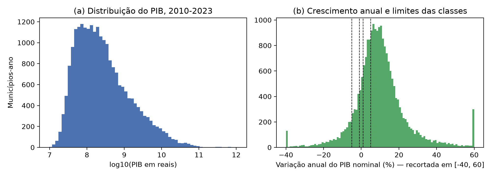
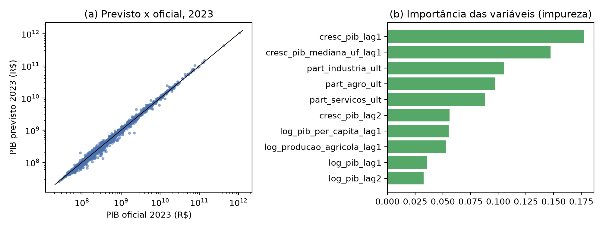
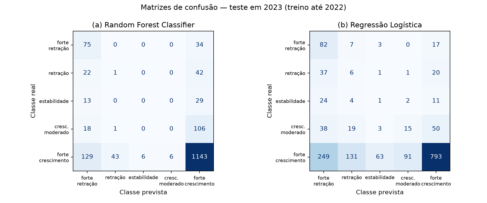

<!--
Organização e edição: Luma. Cada seção técnica foi redigida pelo integrante indicado
(fontes em docs/contribuicao_*.md e nos notebooks). Para gerar o PDF: relatorio/gerar_pdf.sh
Limites: até 15 páginas e até 5 figuras (este relatório usa 3).
-->

# 1. Introdução

*Seção de Lulu; o segundo parágrafo é complemento da edição.*

Este trabalho estima o Produto Interno Bruto (PIB) de 2024 dos municípios da Região Sudeste e busca prever a categoria de crescimento econômico de cada município em relação a 2023. A regressão estima o valor do PIB em milhares de reais correntes. A classificação trata a categoria de crescimento como um alvo separado, com cinco classes definidas pela variação percentual do PIB frente ao ano anterior.

Foram desenvolvidos dois modelos por abordagem, um por integrante: Regressão Linear (Lulu) e Random Forest Regressor (Peter) para o PIB; Regressão Logística (Amanda) e Random Forest Classifier (Luma) para a categoria. Todos seguem a mesma validação temporal: treino com dados até 2022 e teste nas previsões de 2023; depois, reajuste com dados até 2023 e previsão de 2024.

# 2. Dataset

*Seção de Lulu; a frase sobre a integração com o SIDRA é complemento da edição.*

A base inicial utiliza a série do PIB dos Municípios do IBGE para o período de 2010 a 2023. O recorte inclui Espírito Santo, Minas Gerais, Rio de Janeiro e São Paulo. Foram obtidos 23.352 registros, correspondentes a 1.668 municípios em 14 anos, com uma linha por código IBGE do município e ano de referência. A coleta verificou a unicidade dessa chave e a presença de valores positivos de PIB.

Além do PIB total, a base registra o valor adicionado bruto (VAB) da agropecuária, da indústria e dos serviços, em milhares de reais correntes. A publicação não apresenta essa abertura setorial para 2022 e 2023, e a coleta mantém os valores ausentes nesses anos. A integração com o SIDRA acrescentou o valor da produção agrícola (PAM), o efetivo do rebanho bovino (PPM) e a estimativa populacional. Fontes, unidades e lacunas estão em `docs/dicionario_dados.md`.

# 3. Análise exploratória e pré-processamento

*Seção de Peter.*

> **Nota da edição:** Peter ainda não publicou um texto próprio em `docs/`. Esta seção reúne, sem alterar o conteúdo técnico, o texto do notebook `02_eda_preprocessamento.ipynb`, e deve ser revisada por ele.

Os 1.668 municípios do Sudeste (ES 78, MG 853, RJ 92, SP 645) aparecem em todos os 14 anos, sem chaves duplicadas, sem PIB nulo ou negativo e sem códigos de outras regiões. A soma dos três VAB setoriais nunca supera o PIB. Há três registros com VAB setorial negativo, que vêm da própria publicação do IBGE (por exemplo, a indústria de Paulínia em 2012 e 2013) e foram mantidos.

As lacunas são estruturais: o VAB setorial está ausente em 2022 e 2023; a população estimada, em 2010, 2022 e 2023; produção agrícola e rebanho têm cerca de 3% de ausência em todos os anos, em municípios sem registro da atividade.

O PIB municipal é extremamente assimétrico: a mediana fica perto de R$ 200 milhões, enquanto São Paulo passa de R$ 1 trilhão; na escala logarítmica a distribuição fica próxima de simétrica (Figura 1a). O crescimento nominal anual tem mediana em torno de 9%, com caudas longas concentradas em municípios pequenos e dependentes de uma atividade (mineração, petróleo, usinas). Esses casos são valores oficiais e foram mantidos. A classe *forte crescimento* domina quase todos os anos, porque o PIB é nominal (Figura 1b).

{width=95%}

A base de modelagem (`data/processed/base_modelagem.csv`) tem uma linha por município e ano-alvo *t*, de 2011 a 2024. Toda variável explicativa usa apenas anos ≤ *t*−1: log do PIB em *t*−1 e *t*−2, crescimento em *t*−1 e *t*−2, mediana estadual do crescimento em *t*−1, últimas participações setoriais e população conhecidas (com a defasagem em anos), PIB per capita, produção agrícola e rebanho (com `log(1+x)` e indicadores de ausência). Imputação pela mediana, padronização opcional e codificação *one-hot* da UF ficam dentro de um `Pipeline` e são ajustadas apenas nas linhas de treino de cada corte. Um teste reconstrói a base sem os dados do ano *t* e confirma que as variáveis de 2022 e 2023 não mudam, isto é, não há vazamento.

# 4. Modelos

## 4.1 Regressão Linear

*Seção de Lulu.*

O modelo inicial estima o PIB de um município em determinado ano como uma função linear de seu PIB no ano anterior, por mínimos quadrados, com intercepto e inclinação comuns aos municípios. Uma segunda versão acrescentou valor da produção agrícola, rebanho bovino e estimativa populacional com defasagem de dois anos, transformados por log(1 + valor), e um indicador binário para cada ausência. Na avaliação, o ajuste usou pares cujo ano-alvo era no máximo 2022; o PIB de 2022 serviu de entrada para prever 2023. A versão com menor MAPE em 2023 foi reajustada com pares até 2023 para prever 2024.

## 4.2 Random Forest Regressor

*Seção de Peter.*

O Random Forest não extrapola: só prevê valores dentro da faixa vista no treino. Como o PIB nominal cresce todo ano e vai de milhões a trilhões, o modelo não prevê o nível do PIB diretamente. O alvo é o crescimento logarítmico $y_t = \log(PIB_t / PIB_{t-1})$, e a previsão em nível é reconstruída como $\widehat{PIB}_t = PIB_{t-1} \cdot e^{\hat y_t}$. Assim o modelo aprende quanto cada município cresce a partir do seu histórico, estrutura setorial, porte e contexto estadual, e o erro em log se alinha ao MAPE. Os hiperparâmetros (`max_features` = 0,33 e `min_samples_leaf` = 20, com 500 árvores) foram escolhidos treinando até 2021 e validando em 2022, sem olhar 2023.

## 4.3 Classes de crescimento

*Seção de Amanda.*

O alvo é a variação percentual nominal do PIB frente ao ano anterior: `100 × (PIB_t / PIB_t−1 − 1)`. As classes são: forte retração (< −5%); retração (−5% inclusive até −1% exclusive); estabilidade (−1% a 1%, inclusive); crescimento moderado (> 1% até 5%, inclusive); forte crescimento (> 5%). Essa convenção elimina sobreposição nos limites e é usada pelos dois classificadores.

## 4.4 Regressão Logística

*Seção de Amanda.*

A Regressão Logística multiclasse usa as 17 variáveis numéricas defasadas e a UF da base de Peter. Não usa PIB, variação ou classe do próprio ano como entrada. O pipeline aplica imputação pela mediana, indicadores de ausência, padronização e codificação da UF, todos ajustados apenas no treino. Os pesos das classes são balanceados, com regularização padrão e sem busca de hiperparâmetros no teste.

## 4.5 Random Forest Classifier

*Seção de Luma.*

O Random Forest Classifier usa as mesmas classes, entradas e divisão temporal da Regressão Logística; as classes são importadas do código da Amanda. A floresta tem 500 árvores e `class_weight='balanced_subsample'`, que recalcula os pesos das classes em cada amostra bootstrap; sem essa ponderação, o modelo tende a prever apenas *forte crescimento*. `max_features` ∈ {√p, 0,5} e `min_samples_leaf` ∈ {1, 5, 20, 50} foram escolhidos treinando até 2021 e validando em 2022 pelo F1 macro. A configuração escolhida foi `max_features='sqrt'` e `min_samples_leaf=5` (F1 macro de 0,2690 em 2022); folhas com um único exemplo memorizam a classe majoritária e tiveram o pior resultado (0,19).

# 5. Resultados

## 5.1 Regressão: previsão de 2023

| Modelo | R² | MAPE (%) |
| --- | --- | --- |
| Referência: PIB₂₀₂₃ = PIB₂₀₂₂ | 0,9874 | 13,47 |
| Regressão Linear — PIB anterior | 0,9955 | 17,94 |
| Regressão Linear — PIB e indicadores (selecionada) | 0,9955 | 13,21 |
| **Random Forest Regressor** | **0,9985** | **9,00** |

*Lulu:* nos mesmos 1.668 municípios em 2023, a versão ampliada da regressão linear obteve R² de 0,995463 e MAPE de 13,21%, contra 0,995504 e 17,94% para o PIB anterior; a redução de 4,72 pontos percentuais no MAPE motivou a seleção da versão ampliada. O R² resume o ajuste em relação à dispersão dos valores oficiais e é influenciado pela diferença de escala entre as economias municipais; o MAPE atribui o mesmo peso a cada município. Como 2023 orientou a seleção, as métricas também refletem essa escolha.

*Peter:* o Random Forest reduz o MAPE para 9,00%, com erro percentual mediano de 5,99%, contra 13,47% e 12,11% da referência ingênua (Figura 2a). A importância das variáveis é mostrada na Figura 2b.

{width=95%}

## 5.2 Classificação: previsão de 2023

| Modelo | F1 macro | F1 ponderado | Acurácia |
| --- | --- | --- | --- |
| Referência: sempre forte crescimento | 0,1772 | 0,7050 | 0,7956 |
| Regressão Logística | 0,2434 | 0,6008 | 0,5378 |
| **Random Forest Classifier** | **0,2561** | **0,7058** | 0,7308 |

| F1 por classe | Forte retração | Retração | Estabilidade | Cresc. moderado | Forte crescimento |
| --- | --- | --- | --- | --- | --- |
| Regressão Logística | 0,3043 | **0,0517** | **0,0177** | **0,1282** | 0,7151 |
| Random Forest Classifier | **0,4098** | 0,0182 | 0,0000 | 0,0000 | **0,8527** |

*Amanda:* foram avaliados 1.668 municípios; 1.327 tiveram forte crescimento. A classe forte crescimento apresentou o melhor F1 na logística: 793 acertos entre 1.327 casos reais. O modelo identificou 82 dos 109 casos de forte retração, mas também previu retração forte em muitos municípios de outras classes. Os acertos foram apenas 6 em retração, 1 em estabilidade e 15 em crescimento moderado. Os pesos balanceados aumentam a atenção às classes raras, mas não resolvem sua baixa separação. A logística melhora o equilíbrio entre classes medido pelo F1 macro em relação à referência, mas perde no F1 ponderado.

*Luma:* o Random Forest acerta 1.143 dos 1.327 casos de forte crescimento e 75 dos 109 de forte retração, com precisão de 0,29 nesta classe (0,19 na logística). Porém praticamente não prevê as classes intermediárias: 1 acerto em retração e nenhum em estabilidade ou crescimento moderado (Figura 3).

{width=100%}

## 5.3 Seleção dos modelos finais

*Seção de Luma.*

As regras de seleção foram definidas antes da comparação: menor MAPE em 2023 para a regressão, pois o R² fica acima de 0,99 em todos os modelos e quase não discrimina; maior F1 macro em 2023 para a classificação, pois dá o mesmo peso às cinco classes desbalanceadas. As métricas de classificação foram recalculadas a partir das previsões por município dos dois modelos, conferindo que ambos foram avaliados nos mesmos municípios e rótulos.

**PIB final: Random Forest Regressor** (MAPE 9,00% contra 13,21% da regressão linear). **Classe final: Random Forest Classifier**, que supera a logística no F1 macro, no F1 ponderado e na acurácia e tem F1 maior nas duas classes extremas. A vantagem do classificador é modesta: no F1 ponderado ele apenas empata com a referência ingênua, cuja acurácia é maior; o ganho em F1 macro vem quase todo de forte retração; e a logística é melhor nas três classes intermediárias, ainda que com F1 abaixo de 0,13 em todas. Nenhum dos dois classificadores separa bem as variações próximas de zero.

## 5.4 Previsões de 2024

*Seção de Luma.*

O arquivo `outputs/previsoes_finais_2024.csv` tem uma linha para cada um dos 1.668 municípios com o PIB previsto, a variação prevista e a classe prevista, além das previsões alternativas de cada modelo e da classe implícita na variação do PIB previsto, para auditoria. O PIB total previsto do Sudeste em 2024 é de R$ 6,32 trilhões, contra R$ 5,80 trilhões oficiais em 2023 (+9,0% nominal); a variação prevista por município tem mediana de 14,6%.

| Classe | Random Forest Classifier (final) | Regressão Logística | Implícita no PIB previsto |
| --- | --- | --- | --- |
| Forte retração | 178 | 42 | 9 |
| Retração | 3 | 0 | 16 |
| Estabilidade | 1 | 0 | 12 |
| Crescimento moderado | 9 | 0 | 34 |
| Forte crescimento | 1.477 | 1.626 | 1.597 |

A classe prevista coincide com a classe implícita no PIB previsto em 89% dos municípios. A principal divergência são os 178 municípios postos em forte retração pelo classificador, enquanto o regressor prevê queda acima de 5% para apenas 9. Os pesos balanceados fazem o classificador superestimar essa classe rara. A logística, reajustada até 2023, concentra suas previsões nas duas classes extremas. PIB e classe são alvos de modelos diferentes, e o arquivo final mantém ambos para que a divergência seja visível.

# 6. Limitações e conclusão

O PIB analisado é nominal: a inflação entra na variação, o que explica o domínio de forte crescimento, e crescimento nominal não equivale a expansão real. O experimento respeita cortes por ano de referência, mas é retrospectivo: os valores oficiais de 2022 e 2023 foram divulgados em 2025, e a base não arquiva as versões dos dados disponíveis em cada data. Choques econômicos locais, como em municípios dependentes de mineração ou petróleo, são pouco previsíveis a partir do histórico.

Na regressão, modelar o crescimento logarítmico com Random Forest reduziu o MAPE de 13,2% (melhor regressão linear) para 9,0%. Na classificação, os dois modelos superam a referência no F1 macro, mas têm desempenho baixo nas classes intermediárias, que têm poucos exemplos e são sensíveis a pequenas diferenças perto dos limites. O Random Forest Classifier foi escolhido pela métrica principal e pela maior precisão nas classes extremas.

# Referências

- BREIMAN, L. Random forests. *Machine Learning*, v. 45, n. 1, p. 5–32, 2001.
- IBGE. *Produto Interno Bruto dos Municípios: 2010–2023*. Rio de Janeiro: IBGE, 2025. Disponível em: https://ftp.ibge.gov.br/Pib_Municipios/2022_2023/base/.
- IBGE. *Sistema IBGE de Recuperação Automática — SIDRA*: Produção Agrícola Municipal, Pesquisa da Pecuária Municipal e Estimativas da População. Disponível em: https://sidra.ibge.gov.br/.
- PEDREGOSA, F. et al. Scikit-learn: machine learning in Python. *Journal of Machine Learning Research*, v. 12, p. 2825–2830, 2011.

# Contribuição dos autores

| Integrante | Contribuição |
| --- | --- |
| Lulu | Coleta e integração dos dados do IBGE/SIDRA, repositório, README e ambiente; Regressão Linear; seções de Introdução, Dataset e Regressão Linear. |
| Peter (João Pedro Amorim) | EDA, pré-processamento sem vazamento e base de modelagem; Random Forest Regressor; seções de EDA, pré-processamento e Random Forest Regressor. |
| Amanda | Definição das classes de crescimento; Regressão Logística e suas métricas; seções de classes, Regressão Logística e análise de seus resultados. |
| Luma | Random Forest Classifier; comparação dos classificadores e seleção dos modelos finais; consolidação das previsões de 2024; organização e edição do relatório, referências e contribuição dos autores. |
